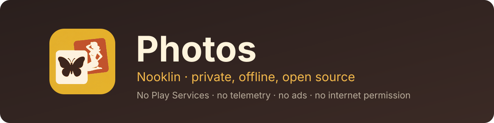

<p align="center">
  
</p>

<h1 align="center">Nooklin Photos</h1>

<p align="center">
  A privacy-first, open-source photo gallery for Android with a little iOS design influence.<br />
  No Google Play Services, no internet permission, no telemetry.
</p>

<p align="center">
  <a href="https://www.gnu.org/licenses/gpl-3.0"></a>
  
  
  
  <a href="mailto:info@nooklin.org"></a>
</p>

<p align="center">
  <a href="#-install"></a>
  <a href="#-features"></a>
  <a href="#-privacy"></a>
  <a href="CHANGELOG.md"></a>
  <a href="#-get-involved"></a>
</p>

<p align="center"></p>

<h2 align="center">🎯 Our Mission</h2>

<p align="center"><b><i>Your photos should stay yours.</i></b></p>

<p align="center">Nooklin Photos is a gallery that works fully offline. Browse, edit, search and organize your photos and videos, with on-device face recognition and a locked Hidden section, and nothing ever leaves your phone unless you share it yourself. Part of the <a href="https://github.com/Nooklin">Nooklin</a> suite of free Android apps.</p>

<h2 align="center">🛡️ Principles</h2>

<div align="center">
<table align="center">
  <tr align="center">
    <td align="center" width="25%" valign="top">
      
      <h4 align="center">No Play Services</h4>
      <p align="center">No Google Play Services dependencies.</p>
    </td>
    <td align="center" width="25%" valign="top">
      
      <h4 align="center">No telemetry</h4>
      <p align="center">No analytics, no crash reporting, no tracking.</p>
    </td>
    <td align="center" width="25%" valign="top">
      
      <h4 align="center">No ads</h4>
      <p align="center">Ever.</p>
    </td>
    <td align="center" width="25%" valign="top">
      
      <h4 align="center">Open source</h4>
      <p align="center">GPL-3.0, so every derivative work stays free too.</p>
    </td>
  </tr>
</table>
</div>

<p align="center"></p>

<h2 align="center">📲 Install</h2>

<p align="center">Download the APK from the latest release and check it against the hashes in the release notes (see <a href="#verify-a-release-apk">Verify a release APK</a>), or let Obtainium keep it up to date.</p>

<p align="center">
  <a href="https://github.com/Nooklin/Photos/releases/latest"></a>
</p>

<p align="center">
  <a href="https://apps.obtainium.imranr.dev/redirect?r=obtainium://add/https://github.com/Nooklin/Photos"></a>
</p>

<p align="center">Requires Android 13 (API 33) or newer.</p>

<p align="center"></p>

<h2 align="center">✨ Features</h2>

- Photo and video grid with a full-screen viewer (swipe, pinch-zoom, video playback)
- Albums, favorites, screenshots, videos, panoramas
- Recently Deleted with 30-day expiry
- Hidden folder, locked with your device biometric or PIN, with its own private Recently Deleted
- Photo editor: rotate, flip, straighten, perspective, crop, styles and adjustments
- Video editor: trim with a strip of frames, the same styles and crop (without perspective); a filter or crop is saved as a new clip
- Photo info sheet with EXIF data
- Search by file name
- Duplicates review: photos that look the same are grouped, you keep one and the rest go to Recently Deleted (needs Machine Learning, Duplicates, and a library scan)
- Share sheet for several photos: a row of apps that accept the share, save to a folder, export the unmodified originals, copy, and for one photo also Print and Use as Wallpaper; Cancel stops a share that is still being prepared
- Metadata removal when sharing (choose what is removed: location, camera and device, date and time, description and other)
- Calendar view and a Years, Months, All timeline in the Library
- Select and a menu in every group of photos and albums (Media Types, Utilities, albums, the Albums and Hidden albums overviews, Search, pets), all in the same style
- Open photos and videos from other apps (a library photo or video opens in the normal viewer), and pick a photo or video for other apps
- Optional on-device People grouping (off by default)
- Light, dark or system theme; square or aspect-ratio grid
- Available in English and Dutch; follows the system language or can be set per app

<h2 align="center">🔒 Privacy</h2>

- The app requests no internet permission, so it cannot send anything off the device.
- No analytics, crash reporting or telemetry of any kind.
- No Google Play Services dependency.
- Face and pet analysis runs fully on the device, using bundled models.
- App data is excluded from Android backup and device transfer.
- Photos leave the device only when you share, print or send them to another app yourself.

<p align="center"></p>

<h2 align="center">🧭 What you need to do yourself</h2>

Some features do nothing until you set them up:

- **People:** open Settings, Machine Learning, switch on "Use machine learning", make sure People is on under "Tags to scan", then run the library scan from the Scan section. After the scan you can give each person a name.
- **Duplicates:** switch on Duplicates under Tags to scan in Settings, Machine Learning, and run the library scan. Duplicates then appears under Utilities on Home.
- **Cars and Motorcycles:** the same scan finds these, no further steps.
- **Scan finished notification (optional):** switch it on in Settings, Notifications, and allow notifications when Android asks.
- **Language:** the app follows the system language. To pick one yourself, open Settings, Appearance, Language.
- **Hiding photos:** the first time you hide a photo, Android asks you to allow media management for Nooklin Photos. After you allow it once, hiding no longer shows the system confirmation.
- **Hidden section:** it is locked with your phone's own biometric or screen lock, so set one up in Android first.

<h2 align="center">⚠️ Known limits</h2>

- RAW photos can be viewed where Android can decode them, but not edited.
- A video with a filter or crop is encoded again as H.264 and saved as a new clip. This can take a while for long videos, and some videos (for example 10-bit HDR) may not export on every phone.
- Search matches file names only.
- Duplicates are matched by a visual fingerprint (a perceptual hash), so edited or very similar photos can be grouped. You always choose what to keep.
- Panoramas are detected by aspect ratio, which is a heuristic.
- Print and Use as Wallpaper work on one photo at a time, not on videos or several photos. Use as Wallpaper hands the photo to an app you choose.
- The apps row in the share sheet lists the apps that accept a share. The app asks for no permission to see all apps, it only asks Android which apps take an image or video share.
- Scrolling in very large libraries (10k+ photos) has not been tested yet.
- Release builds are not minified (R8 is off).

<h2 align="center">📜 Changelog</h2>

<p align="center">The full history is in <a href="CHANGELOG.md">CHANGELOG.md</a>. Every release also has its own notes on the <a href="https://github.com/Nooklin/Photos/releases">releases page</a>.</p>

<p align="center"></p>

<h2 align="center">🛠️ Build</h2>

Requires Android Studio with JDK 17 or newer installed locally (the build does not download a JDK), Android 13 (API 33) or newer to run.

```
.\gradlew assembleDebug
```

For a signed release, copy `keystore.properties.example` to `keystore.properties`, fill it in, then run `.\gradlew assembleRelease`. Never commit the keystore or `keystore.properties`.

<h2 align="center" id="verify-a-release-apk">✅ Verify a release APK</h2>

```
apksigner verify --print-certs photos-v1.0.0.apk
```

Compare the certificate SHA-256 with the value in the release notes, and check the file hash with `Get-FileHash photos-v1.0.0.apk` (PowerShell) or `sha256sum photos-v1.0.0.apk`.

<h2 align="center">📄 License</h2>

<p align="center">GPL-3.0: free to use, free to modify, and any derivative work stays free too. Fonts: Work Sans and Inter (SIL Open Font License 1.1, see THIRD-PARTY-LICENSES).</p>

<h2 align="center">🤝 Get involved</h2>

<p align="center">Found a bug or have an idea? Open an issue on the <a href="https://github.com/Nooklin/Photos/issues">GitHub issue tracker</a>.</p>

<p align="center">Have a question, or just want to say hi? Reach out at <a href="mailto:info@nooklin.org">info@nooklin.org</a>.</p>

<p align="center"></p>

<p align="center">
  <sub>Nooklin Photos · Free, open-source Android app under GPL-3.0 · <a href="mailto:info@nooklin.org">info@nooklin.org</a></sub>
</p>
